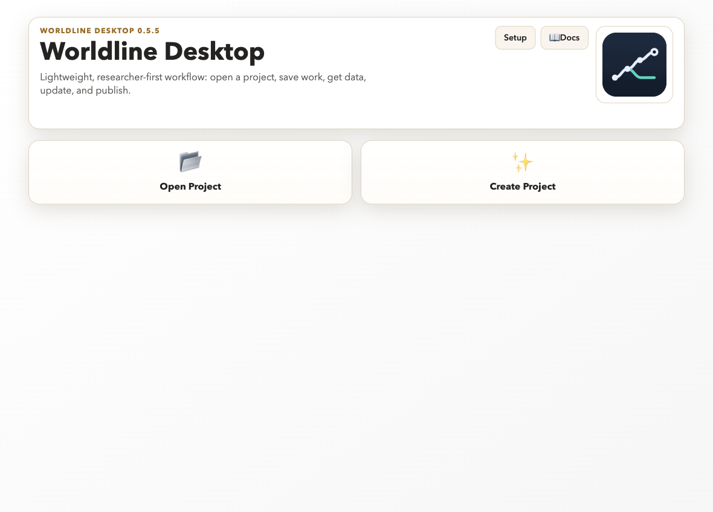
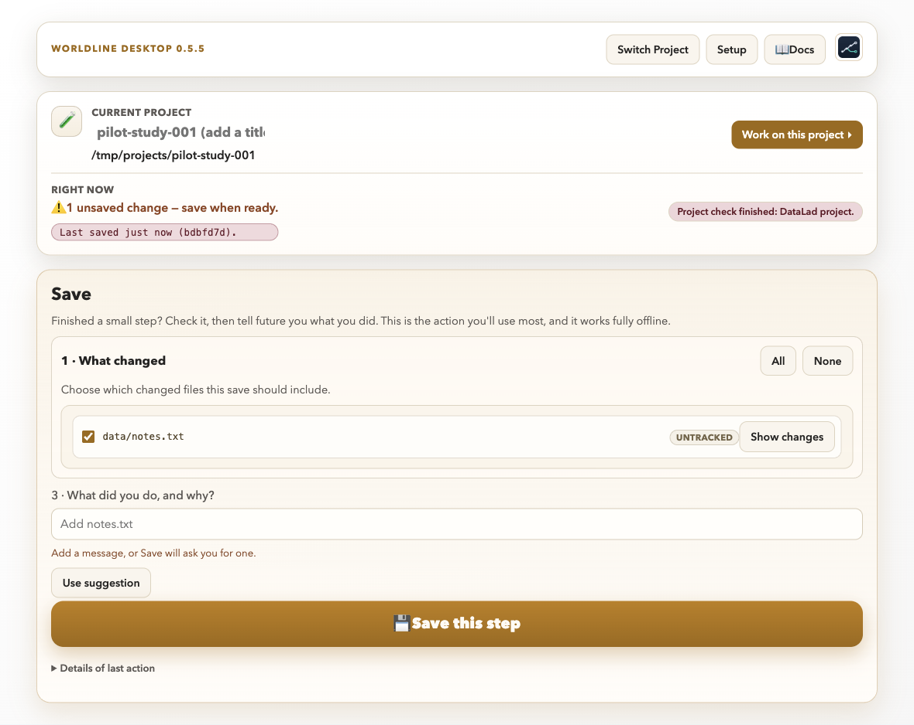

# Tutorial 00: Create your first project

## Scenario

You are starting a brand-new scientific project and want a safe, reproducible
foundation before any data cleaning or analysis.

**Level:** Beginner · **Time:** 15 to 25 minutes

## Skills trained

- Check local tool setup
- Create a new DataLad project from the app
- Confirm the project card shows a healthy DataLad project
- Make the first minimal save

## Setup

1. Choose a **location** (an existing parent folder) and a **project name**
   for the new project. The app creates the project as a new folder inside the
   location, for example:
   - location `/path/to/projects`, name `pilot-study-001`
2. Keep one short project note ready for first Save:
   - study purpose sentence
   - owner or team name

3. On first launch the app asks for your **name and email**. Enter them once; they
   label every save, and you can change them later under
   **Setup → Your Name and Email**. Save stays blocked until they are set.

## Why the empty-folder rule matters

DataLad project creation initializes version-control structure in the target
folder. If that folder already contains files, DataLad cannot safely assume
which existing content belongs to the new project baseline. Starting in an
empty or brand-new folder prevents accidental mixing of unrelated files and
keeps the first save scientifically auditable.

## Walkthrough tasks

1. In the app header, click **Setup**, then **Check Environment**.
2. Confirm Python 3, DataLad, and git-annex report `OK`.
3. Click the **Create Project** tile. Enter the parent folder in **Location**
   and `pilot-study-001` in **Project name**. The line below the fields shows
   where the project will be created.
4. Click **Create Project**.

   

5. Verify the project opens. The project card shows the project name, its folder and a line such as
   "Project check finished: DataLad project." A plain Git folder (no DataLad) gets a **Git** badge instead.

   

6. Add an initial `README.md` line in the project folder.
7. Return to the app, review the changed-file list, and Save with message:
   - `init: create project skeleton and first note`

## Failure injection

- Try creating into a non-empty folder once: click **Switch Project**, open the
  **Create Project** tile, and enter the same **Location** and **Project name**
  as before.
- Confirm the warning and explain what content would have been mixed.
- Recover by entering a different **Project name** (a new folder) and repeating creation.

## Completion criteria

- Environment check shows required tools available.
- Project creation succeeds from the app.
- A first save exists with a clear intent message.

## Debrief

- Why is project creation inside the app a better first step for new users?
- What lab-wide template content should go into the very first save?
