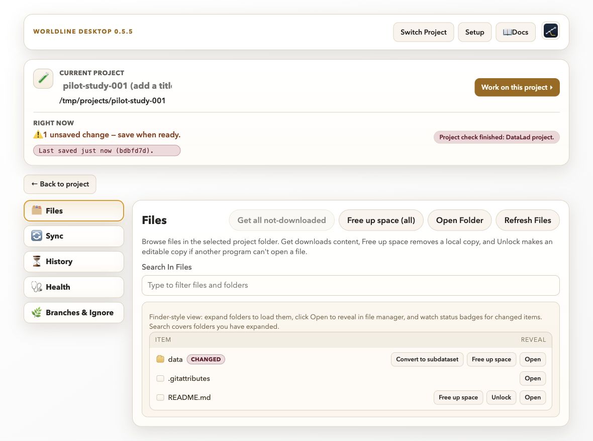
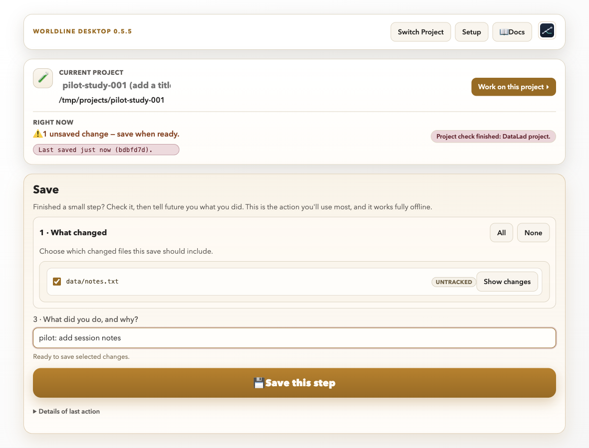

# Tutorial 1: First save in a small project

## Scenario

You are a single researcher continuing from Tutorial 00. You now inspect local
changes in the newly created project and make a clean first save.

**Level:** Beginner · **Time:** 20 to 30 minutes

## Skills trained

- Open an existing project
- Read working-tree status
- Select files for Save (step 1)
- Write clear Save messages
- Verify a successful save

## Setup

1. Start from the project created in Tutorial 00.
2. Add project files:
   - `README.md`
   - `data/raw/participants.tsv`
   - `analysis/notebook.ipynb`
3. Make two edits before opening the project view:
   - Add one line to `README.md` describing the pilot aim.
   - Modify one value in `participants.tsv`.
4. Leave one scratch file untracked: `notes/todo.txt`.

## Walkthrough tasks

1. Open the project in Worldline Desktop.
2. Look at the project card: it names the project and says what the project check found. A project made in Tutorial 00 reads "DataLad project". A plain Git folder shows a **Git** badge.
3. The **Save** area opens in three small steps. Step **1 · What changed** lists the changed and untracked files.
   Click **Show changes** next to a file to see exactly what changed in it before you save.

   

4. Every changed file starts ticked. Keep the ticks on the research files
   (`README.md`, `data/raw/participants.tsv`).
5. Untick the scratch note `notes/todo.txt`.
6. Step **3 · What did you do, and why?**: write a message in this format. A very vague message ("update", "fix", "wip") gets a nudge, never a block. **Use suggestion** fills in a starting text:
   - `pilot: update participant table and project summary`

   

7. Click **Save this step**. In a BIDS or PRISM project, step **2 · Is it valid?** shows the check result first; a fresh "not valid" result holds the save back until you fix it.
8. Re-check the list of changed files. The saved files are gone from it, and
   only `notes/todo.txt` is left. Open **Work on this project → History** to see your new
   save at the top.

## Failure injection

- Tick `notes/todo.txt` and Save it once, as if by mistake.
- The app saves the file like any other: it is now part of the project's
  history. Open **Work on this project → History** and select that save to see which files
  it contains. The app has no button that takes one file out of an earlier
  save. To keep scratch files out in future, add a rule under **Work on this project → Branches & Ignore → Ignore Rules** before they are saved, or leave them unticked as above.

## Completion criteria

- User can explain why each saved file belongs in history.
- Save completes without conflict warnings.
- Project status reflects expected remaining untracked files.

## Debrief

- What made the Save message useful for future collaborators?
- Which files should stay out of scientific history and why?
